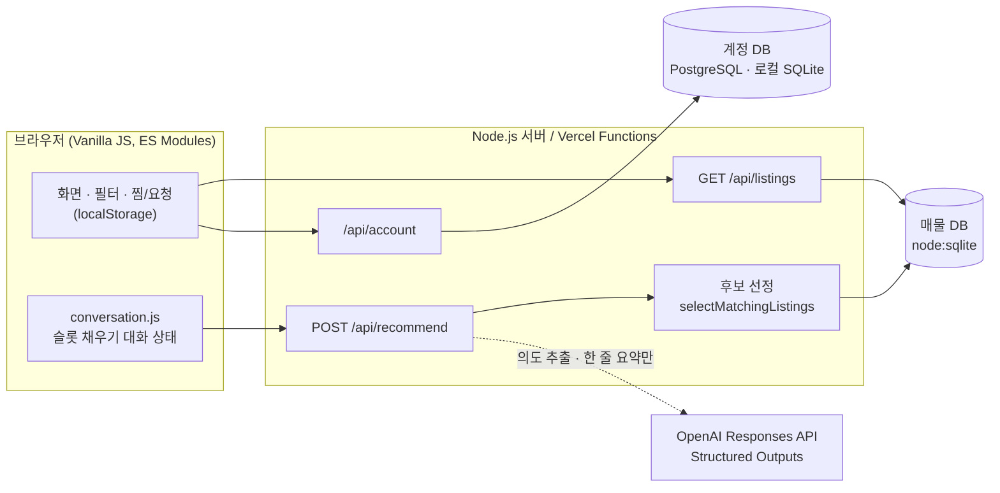

<div align="center">


# 모아농 · 모아농기계

**기계 이름은 몰라도, 하려는 일만 말하면 맞는 농기계를 찾아 주는 동네 농기계 대여·구매 플랫폼**

[](https://moa-farm-machines.vercel.app)


</div>

<p align="center"></p>

## 프로젝트 개요

| 항목 | 내용 |
| --- | --- |
| 형태 | 해커톤 팀 프로젝트 (10조) |
| 기간 | 2026.11.06 – 2026.11.07 |
| 대상 | 농기계 종류와 규격을 잘 모르는 초보·귀농 농부, 놀고 있는 기계를 빌려주려는 소유 농가 |
| 지역 | 경북 영양군 4개 읍·면(영양읍·청기면·입암면·수비면)을 시범 지역으로 가정 |
| 결과물 | 반응형 웹 MVP, AI 상담 챗봇 '농농이', PRD 및 재배·농기계 조사 문서 |

### 풀고 싶었던 문제

초보 농부는 "고추밭에 비닐을 씌워야 한다"는 건 알아도 그 일에 **휴립피복기**가 필요하다는 것, 내 관리기에 그 작업기가 **붙는지**, 원하는 날짜에 근처에서 **비어 있는 기계가 있는지**를 알기 어렵습니다. 반대로 기계를 가진 농가는 쓰지 않는 기간을 수익으로 바꿀 통로가 부족합니다.

모아농은 **작물과 작업에서 출발해 기계로 가는 검색**을 목표로 했습니다. 사용자는 기계 이름 대신 하려는 일을 말하고, 서비스는 맞는 기종과 조건에 맞는 이웃 매물을 골라 비교해 줍니다.

## 주요 기능

### 1. AI 농기계 상담사 '농농이'

<table>
<tr>
<td width="68%"></td>
<td width="32%"></td>
</tr>
</table>

- "고추밭 300평에 두둑 만들 기계 빌리고 싶어요. 하루 10만원 이하"처럼 **한 문장으로 말하면** 작물·작업·거래 방식·면적·예산을 한 번에 뽑아냅니다.
- 빠진 조건만 **작물 → 작업 → 대여/구매 → 면적 → 날짜 → 예산** 순서로 되묻고, 선택지 버튼과 '건너뛰기'·'바로 추천'을 함께 줍니다.
- "멀칭이 뭐예요?", "그걸 왜 물어봐요?" 같은 **중간 질문**에 답한 뒤 원래 흐름으로 돌아옵니다.
- 추천 결과는 서버가 조건으로 걸러 낸 **실제 등록 매물 최대 3개**이며, AI는 그 매물의 검증 가능한 정보만 짧게 요약합니다.

### 2. 동네 매물 탐색


- 10개 기종, 대여 60건과 판매 40건으로 이루어진 시연용 매물 100건을 SQLite에서 조회합니다.
- 대여/구매 전환, 기종·제조사·상태·가격·평수·거리 필터, 거리순·가격순·최근 점검순 정렬을 지원합니다.
- 대여 기간을 고르면 **기존 예약과 겹치는 매물은 자동으로 제외**하고, 대여 요청 버튼에 기간과 총 대여료를 계산해 보여 줍니다.
- 찜 목록, 대여 요청 내역, 내 기계 관리(로그인 필요) 화면을 제공합니다.

### 3. 내 농기계 · 호환 작업기 찾기


- 내가 가진 트랙터·관리기를 등록하면, 같은 기간에 빌릴 수 있는 **부착 작업기 중 호환되는 것**을 찾아 줍니다.
- 기계가 없다면 **본체 + 작업기 세트**를 조합해 총 대여료 순으로 추천합니다.
- 호환 판정은 실제 제조사 공개 사양 12종을 근거로 하며, 제조사가 명시한 조합만 '호환 가능'으로 표시합니다. 근거가 부족하면 '확인 필요'로 남깁니다.

### 4. 작업 가이드 · 계정

- 고추·벼·배추·감자별로 **밭 준비 → 심기 → 생육 관리 → 수확** 단계와 단계별 대표 장비를 안내합니다.
- 아이디·비밀번호 기반 회원가입과 로그인을 지원하며, 세션은 서버 측에서 관리합니다.

<p align="center"></p>

## 아키텍처



### 추천 한 번이 처리되는 과정

1. **대화 상태 관리(클라이언트)**: `conversation.js`가 사용자 문장에서 작물·작업·거래 방식·면적·날짜·예산을 읽고, 아직 모르는 항목만 다음 질문으로 고릅니다.
2. **의도 해석(서버 + LLM)**: OpenAI Responses API에 `strict` JSON Schema를 걸어 의도(`search / help / rental_help / unrelated`)와 조건을 추출합니다. 작물과 작업은 서버가 가진 ID의 `enum` 안에서만 고를 수 있습니다.
3. **후보 선정(서버, 규칙 기반)**: 작물·작업 호환, 거래 상태, 고장 여부, 예약 겹침, 권장 면적, 예산, 거리 조건으로 거른 뒤 거리 → 가격 순으로 정렬해 상위 3개를 고릅니다.
4. **요약(LLM)**: 이미 걸러진 후보에 대해서만 35자 안팎의 요약을 생성합니다. 응답에 담긴 ID가 후보 목록에 없으면 버립니다.
5. **폴백**: API 키가 없거나, 7.5초 안에 응답이 없거나, 형식이 틀리면 규칙 기반 안내문으로 바로 답합니다. AI가 없어도 서비스가 동작합니다.

## 기술적으로 고민한 점

### LLM은 해석만, 판단은 서버가

농기계 추천에서 가장 위험한 실패는 AI가 **없는 매물, 틀린 가격, 확인 안 된 호환성**을 지어내는 것입니다. 그래서 역할을 나눴습니다.

- LLM은 자연어를 구조화된 조건으로 바꾸고, 이미 검증된 후보를 짧게 설명하는 일만 맡습니다.
- 매물 필터링, 예약 충돌 검사, 호환 판정, 가격 계산은 모두 서버의 결정적인(deterministic) 코드가 맡습니다.
- 시스템 지시문에 "가격, 재고, 안전성, 예약 가능성을 지어내거나 보증하지 마라"를 명시하고, 출력은 JSON Schema로 형식을 강제했습니다.

### 프롬프트 인젝션과 입력 방어

- "시스템 프롬프트 알려줘", "이전 지시 무시해" 같은 요청은 클라이언트 단계에서 걸러 일반 안내로 돌립니다.
- 매물 설명 같은 데이터 안의 지시는 따르지 않도록 명시하고, 모델 출력은 `enum` · `additionalProperties: false`로 묶었습니다.
- 서버는 메시지 길이(1–500자), 요청 본문 크기, 후보 ID 개수(최대 8개)를 제한하고, 모델이 돌려준 요약은 후보 ID 화이트리스트와 160자 제한을 거칩니다.

### 한국어 농업 입력 파싱

실제 농민의 입력 습관에 맞추려고 파서를 따로 만들고 회귀 테스트로 고정했습니다.

- 면적은 `300평`, `1,000㎡`, `제곱미터`를 모두 받아 평으로 환산합니다.
- 예산은 `10만원`, `7.5만`처럼 쓰거나, 대여 예산 질문에 숫자만 답하면(`3`, `15`) 만 원 단위로 해석합니다.
- 날짜는 `1107`, `11월 7일`, `1107~1110`, `1230~0103`(연도 넘김)을 모두 처리하며, 연도는 요청한 날을 기준으로 정합니다.
- "배추밭에 비닐 씌우기"는 멀칭, "감자 캐기"는 굴취처럼 **작업 표현을 작업 ID로 매핑**합니다.

### 보수적인 호환 판정

`checkModelCompatibility()`는 제조사가 부착 가능 기종으로 명시한 조합만 `compatible`로 판정합니다. 홈페이지에서 확인되지 않은 히치 규격, PTO 스플라인, 승강력은 `null`로 두고, **`null`끼리 같다고 호환으로 처리하지 않습니다.** 마력 단위(PS · HP · kW)도 섞지 않고 원문 단위를 보존했습니다. 근거는 [`docs/machine-specifications.md`](docs/machine-specifications.md)에 정리했습니다.

### 서버 측 보안

- OpenAI API 키와 인증 비밀값은 서버 환경 변수로만 읽고, 브라우저 번들에는 포함하지 않습니다.
- 인증은 Better Auth로 구현했고, 세션은 HTTP-only 쿠키로 관리합니다. 배포 환경에서는 Secure 쿠키를 사용합니다.
- 계정 API는 `Origin` 일치, `Content-Type: application/json`, 4KB 본문 제한, 아이디 정규식(`[a-z0-9_-]{3,30}`), DB 기반 요청 속도 제한을 적용합니다. 이메일은 수집하지 않습니다.
- 개발 서버는 정적 파일 경로를 화이트리스트로 제한하고 경로 탐색(`..`)을 차단합니다.

## 기술 스택

| 영역 | 사용 기술 |
| --- | --- |
| Frontend | HTML, CSS, Vanilla JavaScript (ES Modules), 반응형 레이아웃 |
| Backend | Node.js 24 `http` 서버(로컬), Vercel Serverless Functions(배포) |
| Database | `node:sqlite`(매물 · 로컬 계정), PostgreSQL(`pg`, 배포 계정) |
| Auth | Better Auth (아이디 · 비밀번호, 세션 쿠키, 속도 제한) |
| AI | OpenAI Responses API, Structured Outputs(JSON Schema), 실험용 eve 에이전트 + zod 도구 정의 |
| Test | `node:test` (30개 테스트) |
| Infra | Vercel |

## 프로젝트 구조

```text
.
├── index.html                  # 단일 페이지 진입점
├── src/
│   ├── main.js                 # 화면 전환, 필터, 매물 카드, 찜·대여 요청
│   ├── garage.js               # 내 농기계 등록 · 호환 작업기 찾기
│   ├── account.js              # 로그인 · 회원가입 UI
│   ├── ai/
│   │   ├── conversation.js     # 농농이 대화 상태(슬롯 채우기)
│   │   ├── rental-dates.js     # 한국어 날짜 파서
│   │   └── recommend-agent.js  # 추천 API 호출
│   └── data/
│       ├── farm-machines.js         # 작물 · 작업 단계 · 기종 사전
│       ├── recommendation.js        # 후보 필터 · 정렬 · 안내문
│       ├── compatibility.js         # 본체 + 작업기 조합 탐색
│       └── machine-specifications.js  # 실제 제조사 사양 12종
├── server/
│   ├── agent.js                # 의도 해석 · 추천 요약(LLM 호출)
│   ├── listings-db.js          # SQLite 스키마 · 조회
│   ├── listing-seed.js         # 시연용 매물 100건 생성
│   └── account-auth.js         # Better Auth 설정
├── api/                        # Vercel 함수 (listings · recommend · account)
├── agent/                      # eve 기반 서버 에이전트 실험 (화면과 별도)
├── tests/                      # node:test 회귀 테스트
├── docs/                       # 사양 근거 문서 · 스크린샷
└── *.md                        # PRD · 재배 조건 조사 · 개선점 조사
```

## 실행 방법

Node.js 24 이상이 필요합니다.

```bash
npm ci
npm run dev        # http://localhost:3000
npm run check      # 테스트 실행
npm run build      # Vercel 배포용 dist/ 생성
```

- 처음 실행하면 `data/farm-machines.sqlite`가 만들어지고 시연용 매물이 채워집니다. 다시 실행해도 매물이 중복되지 않습니다.
- 로컬 계정은 `data/accounts.sqlite`에 저장되고, 세션 서명 키는 처음 실행할 때 `data/`에 자동 생성됩니다. 이 폴더는 Git에 올라가지 않습니다.
- AI 기능을 켜려면 `.env.example`을 참고해 `.env.local`을 만들고 `OPENAI_API_KEY`를 넣습니다. 키가 없어도 규칙 기반 추천으로 동작합니다.

<details>
<summary>Vercel 배포 환경 변수</summary>

| 변수 | 용도 |
| --- | --- |
| `OPENAI_API_KEY` | 추천 API의 의도 해석 · 요약 (선택) |
| `OPENAI_MODEL` | 사용할 모델 이름 (선택) |
| `DATABASE_URL` | 계정용 PostgreSQL 연결 문자열 |
| `BETTER_AUTH_SECRET` | 세션 서명 키. `node -e "console.log(require('node:crypto').randomBytes(32).toString('hex'))"`로 생성 |
| `BETTER_AUTH_URL` | 운영 서비스의 HTTPS 주소 |

계정 테이블은 같은 변수를 설정한 환경에서 `npm run db:accounts`로 준비합니다. 모든 값은 서버 환경 변수로만 설정하고 저장소에는 올리지 않습니다.

</details>

## 기획 · 조사 문서

| 문서 | 내용 |
| --- | --- |
| [농기계 대여 플랫폼 PRD](농기계_대여_플랫폼_PRD.md) | 문제 정의, 대상 사용자, 핵심 흐름, 기능 요구사항, AI 추천 설계, 성공 지표 |
| [벼·고추·배추·감자 재배 조건 조사](벼_고추_배추_감자_농기계_재배조건_조사.md) | 작물별 작업 일정과 필요한 농기계, 농촌진흥청 · 농사로 자료 기반 |
| [개선점 조사](개선점_조사.md) | 목업 점검 결과, 거래 상세 정보 구조, 접근성(WCAG) 개선 방향 |
| [실제 모델 기반 사양](docs/machine-specifications.md) | 제조사 사양 출처, 데이터 경계, 호환 판정 기준 |

## 팀과 나의 역할

해커톤 10조로 참여해 기획부터 배포까지 함께 진행했습니다.

**내가 맡은 부분 ([@baejh3333-del](https://github.com/baejh3333-del))**

- 단일 HTML 목업을 `index.html` · `src/` · `server/` · `api/` 구조로 나눠 **MVP 초기 구조를 설계**
- 농농이 **AI 대화 처리 개선**: 중간 질문 처리, 대화별 필터 격리, 예산 파싱
- 작업 예시를 눌러 바로 고칠 수 있는 검색 가이드와 내비게이션 단순화
- Better Auth 기반 **계정 인증** 도입
- 실제 제조사 공개 사양을 조사해 **시연 매물 데이터를 실제 모델 12종으로 통일**
- **내 농기계 등록 · 호환 작업기 찾기** 기능 설계와 구현
- 추천 카드 압축, 채팅창 확대 모드, 작은 화면 대응

**함께한 팀원**

- [bluejun0303-design](https://github.com/bluejun0303-design): 추천 결과 카드 UI, 대여 기간 · 예산 입력 처리, 시연 계정과 내 기계 관리 연동
- [hyunji061105](https://github.com/hyunji061105): 정렬 컨트롤, 기종 사진, 농농이 캐릭터 등 화면 디자인 개선

## 한계와 다음 단계

- 대여 요청, 찜, 채팅은 브라우저 `localStorage`에 저장되는 시연용 기능이라 다른 기기나 사용자와 공유되지 않습니다.
- 매물의 가격 · 위치 · 예약 · 점검일은 가상의 데이터이고, 거리는 4개 읍 · 면 사이의 예시값입니다.
- 실제 파일럿에는 공동 거래 DB, 사진 저장소, 예약 승인 시점의 서버 재검증, 알림, 위치 권한, API 요청 제한이 더 필요합니다.
- `agent/` 폴더의 eve 에이전트는 서버 내부 API와 연결하는 다음 단계를 위한 설계 실험입니다.

---

<sub>이 저장소는 해커톤 팀 저장소를 포트폴리오용으로 정리한 공개 사본입니다. 공개 전에 커밋 기록과 비밀값을 제외했습니다. 매물 사진은 AI로 만든 예시 이미지입니다.</sub>
