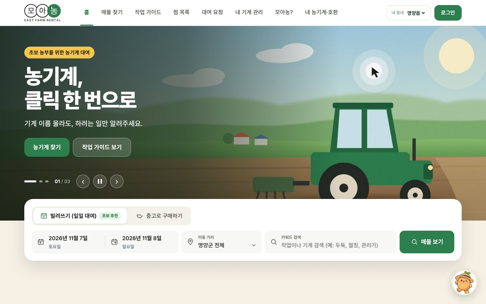
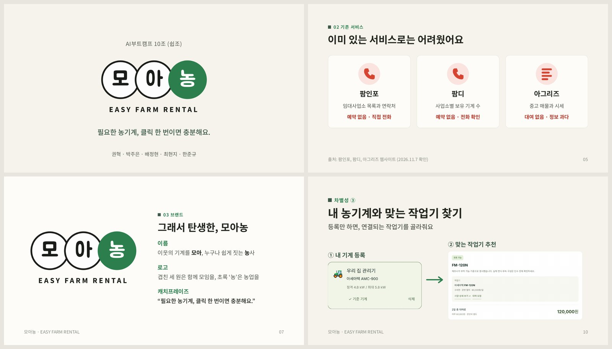
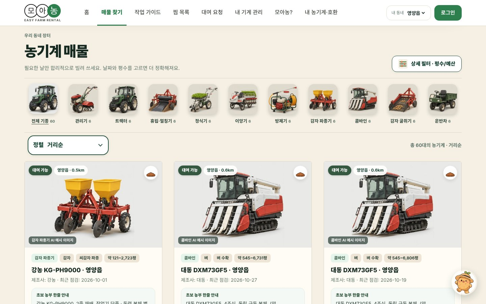
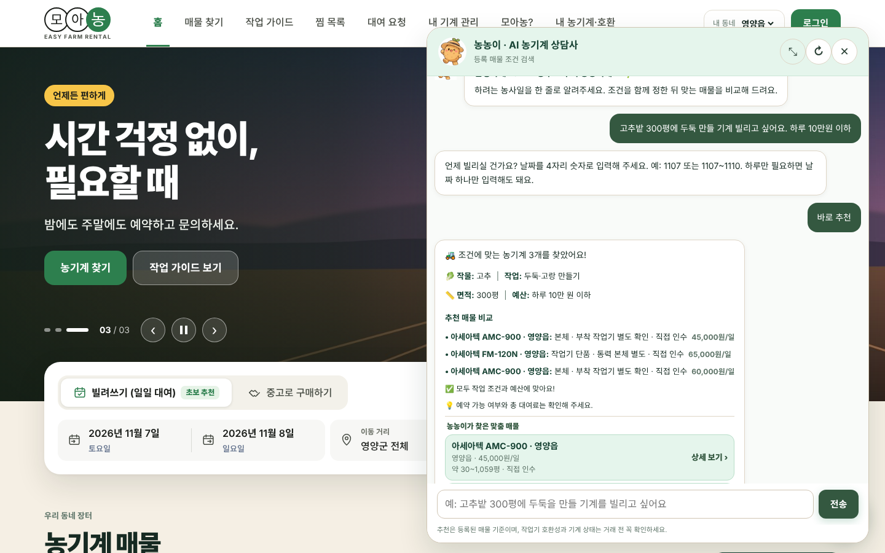
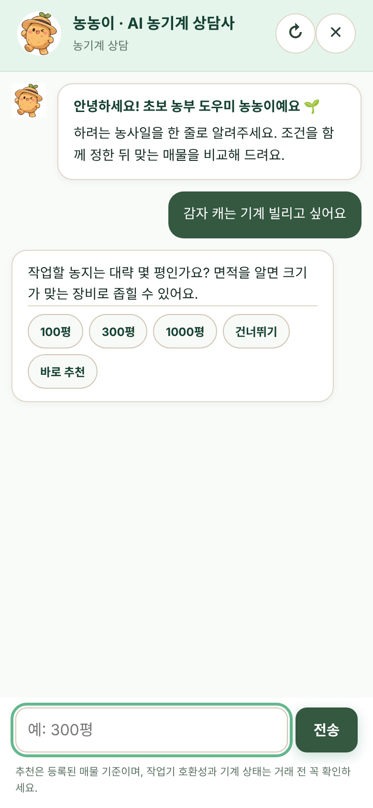
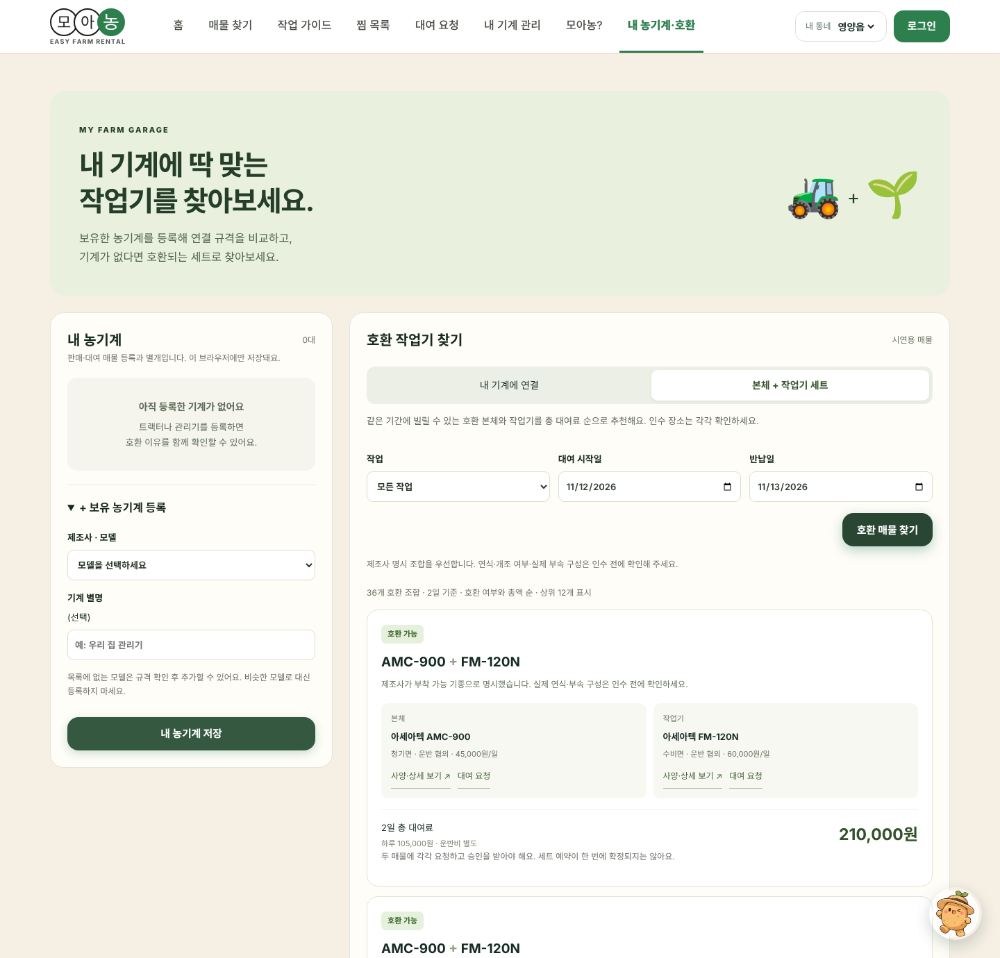
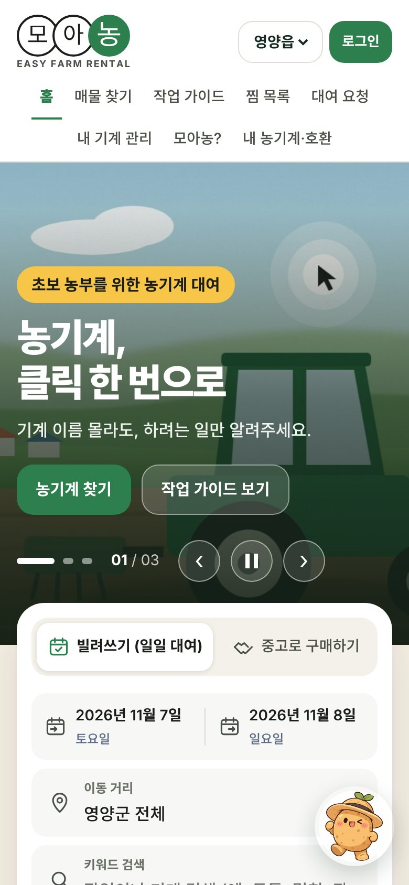
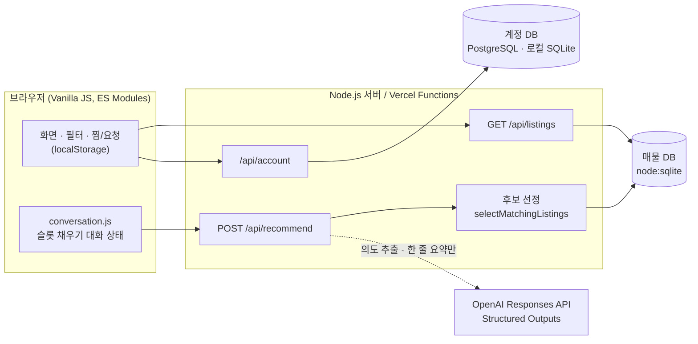

<div align="center">


# 모아농 · 모아농기계

**기계 이름은 몰라도, 하려는 일만 말하면 맞는 농기계를 찾아 주는 동네 농기계 대여·구매 플랫폼**

🏆 **2026 강원대학교 AX Challenge · 프로젝트 트랙 종합 대상**

[](https://moa-farm-machines.vercel.app)

[발표자료](docs/portfolio/모아농_발표자료.pdf) · [기능 화면 캡처집](docs/portfolio/모아농_기능화면.pdf) · [협업 과정 기록](docs/협업_과정.md)


</div>

<p align="center"></p>

## 프로젝트 개요

| 항목 | 내용 |
| --- | --- |
| 수상 | 🏆 **프로젝트 트랙 종합 대상** |
| 대회 | [2026 강원대학교 AX Challenge](https://biology.kangwon.ac.kr/biology/community/notice.do?mode=view&articleNo=577308&article.offset=0&articleLimit=10) · 강원대학교 AI분야 첨단산업 인재양성 부트캠프사업단 주관, 1박 2일 아이디어톤 |
| 팀 | 10조(쉽조), 5인 |
| 기간 | 2026.11.06 – 2026.11.07 (1박 2일, 강릉) |
| 대상 사용자 | 농기계 종류와 규격을 잘 모르는 초보·귀농 농부, 놀고 있는 기계를 빌려주려는 소유 농가 |
| 지역 | 경북 영양군 4개 읍·면(영양읍·청기면·입암면·수비면)을 시범 지역으로 가정 |
| 결과물 | 반응형 웹 서비스, AI 상담 에이전트 '농농이', PRD, 발표자료, 기능 화면 캡처집 |

### 풀고 싶었던 문제

처음 농사를 짓는 사람에게 농기계는 가장 높은 벽입니다.

- **어떤 기계가 필요하지?** "고추밭에 비닐을 씌워야 한다"는 건 알아도, 그 일에 **휴립피복기**가 필요하고 내 관리기에 **붙는지**까지 판단하기는 어렵습니다.
- **사기엔 너무 비싸.** 1년에 며칠 쓰는 기계를 사기엔 부담이 큰데, 원하는 날짜에 근처에서 **비어 있는 기계**가 있는지 알기 어렵습니다.
- **어디에 물어봐야 해?** 기존 서비스는 대부분 전화로 문의해야 합니다.

반대로 기계를 가진 농가는 쓰지 않는 기간을 수익으로 바꿀 통로가 마땅치 않습니다. 모아농은 **기계가 필요한 초보 농업인**과 **기계가 남는 이웃 농가**를 동네 안에서 연결합니다.

### 기존 서비스와의 차이

| 서비스 | 제공 정보 | 한계 |
| --- | --- | --- |
| 팜인포 | 임대사업소 목록과 연락처 | 예약 없음 · 직접 전화 |
| 팜디 | 사업소별 보유 기계 수 | 예약 없음 · 전화 확인 |
| 아그리즈 | 중고 매물과 시세 | 대여 없음 · 정보 과다 |
| **모아농** | **작업 기반 AI 추천, 이웃 농가 매물, 호환 작업기** | **전화 없이 날짜 선택 후 대여 요청** |

<sub>출처: 각 서비스 웹사이트 (2026.11.7 확인)</sub>

기존 서비스는 화면이 복잡하고, 사업소나 업체 단위로 정보를 보여 주며, 결국 전화로 확인해야 하고, 초보자를 위한 설명이 부족했습니다. 모아농은 **작물과 작업에서 출발해 기계로 가는 검색**을 목표로 했습니다. 사용자는 기계 이름 대신 하려는 일을 말하고, 서비스는 맞는 기종과 조건에 맞는 이웃 매물을 골라 비교해 줍니다.

| 차별점 | 내용 |
| --- | --- |
| ① 초보 맞춤 AI 에이전트 '농농이' | 하려는 작업만 말하면 농기계 추천, 기계별 간단한 사용 가이드, 대여·구매 중 맞는 방식 안내 |
| ② 전화 없이 클릭 한 번으로 대여 | 대여·반납 날짜 고르기 → 가까운 매물 선택 → 대여 요청 끝 |
| ③ 내 농기계와 맞는 작업기 찾기 | 보유 기계를 등록하면 연결되는 작업기만 골라 줌 |

### 브랜드



- **이름**: 이웃의 기계를 **모아**, 누구나 쉽게 짓는 **농**사
- **로고**: 겹친 세 원은 함께 모이는 것을, 초록색 '농'은 농업을 뜻합니다.
- **캐치프레이즈**: "필요한 농기계, 클릭 한 번이면 충분해요."
- **마스코트**: AI 상담사 '농농이'
- **설계 원칙**: 기능은 적게, 길은 짧게. 초보 농부가 망설이지 않고 바로 끝낼 수 있는 기능만 남겼습니다.

## 주요 기능

> 전체 27개 화면은 [기능 화면 캡처집(PDF)](docs/portfolio/모아농_기능화면.pdf)에서 볼 수 있습니다.

### 1. 메인 화면과 매물 탐색



- 메인 화면은 초보 농업인도 쉽게 읽고 찾아갈 수 있도록 큰 글씨와 단순한 동선으로 디자인했습니다. 배너 3장이 자동으로 넘어가고, 날짜·이동 거리·키워드로 빠르게 검색할 수 있습니다.
- 상단의 **내 동네**(영양읍·청기면·입암면·수비면)를 바꾸면 거리 기준이 바뀌어 가까운 매물부터 다시 정렬됩니다.
- **거리순 · 낮은 가격순 · 최근 점검순**으로 정렬할 수 있습니다. 최근 점검순은 기계 상태를 확인하려는 사용자를 위한 기준입니다.
- **상세 필터**로 재배 작물, 농사 단계, 세부 작업, 농기계 종류, 농지 크기(평), 1일 예산, 이동 거리, 대여 날짜, 제조사, 기계 상태를 한 화면에서 고를 수 있습니다.
- **매물 상세**에는 실제 모델 사양(엔진·출력·중량·PTO·연결 방식)과 제조사 상세 정보 링크, 대여 일정과 비용, 사용 안내, 인수 전 체크리스트가 들어 있습니다.
- 대여 기간을 고르면 **기존 예약과 겹치는 매물은 자동으로 제외**하고, 대여 신청 버튼에 기간과 총 대여료를 계산해 보여 줍니다.
- 시연용 매물은 10개 기종, 대여 60건과 판매 40건으로 모두 100건이며 SQLite에서 조회합니다.

### 2. AI 농기계 상담사 '농농이'

<table>
<tr>
<td width="68%"></td>
<td width="32%"></td>
</tr>
</table>

- LLM을 API로 연결해 자연스럽게 대화할 수 있는 에이전트로 만들었습니다.
- "고추밭 300평에 두둑 만들 기계 빌리고 싶어요. 하루 10만원 이하"처럼 **한 문장으로 말하면** 작물·작업·거래 방식·면적·예산을 한 번에 뽑아냅니다.
- 빠진 조건만 **작물 → 작업 → 대여/구매 → 면적 → 날짜 → 예산** 순서로 되묻고, 선택지 버튼과 '건너뛰기'·'바로 추천'을 함께 줍니다.
- "멀칭이 뭐예요?", "그걸 왜 물어봐요?" 같은 **중간 질문**에 답한 뒤 원래 흐름으로 돌아옵니다.
- 추천 결과는 서버가 조건으로 걸러 낸 **실제 등록 매물 최대 3개**이며, AI는 그 매물의 검증 가능한 정보만 짧게 요약합니다.
- 추천된 작업기를 누르면 실제 모델 사양과 상세 정보 사이트로 이어지고, **대여 신청하기**로 바로 요청을 보낼 수 있습니다.

### 3. 내 농기계 · 호환 작업기 찾기



농기계를 쓰려면 본체와 작업기의 **연결 규격, 유압 호환성, 동력** 등 따져야 할 것이 많습니다. 이 기능은 초보 농부가 어려운 자료 조사나 문의 없이 호환 여부를 바로 확인할 수 있게 해 줍니다.

- **내 기계에 연결**: 가진 트랙터·관리기를 기준 기계로 등록하면, 같은 기간에 빌릴 수 있는 작업기마다 호환 가능 여부와 이유, 대여료를 보여 줍니다. '호환 가능한 작업기만' 보기도 지원합니다.
- **본체 + 작업기 세트**: 기계가 없다면 같은 기간에 함께 빌릴 수 있는 호환 조합을 총 대여료 순으로 추천합니다.
- 호환 판정은 실제 제조사 공개 사양 12종을 근거로 합니다. 제조사가 명시한 조합만 '호환 가능'으로 표시하고, 근거가 부족하면 '확인 필요'로 남깁니다.

### 4. 작업 가이드 · 찜 · 대여 요청 · 계정

- **작업 가이드**: 고추·벼·배추·감자별로 **밭·논 준비 → 심기 → 생육 관리 → 수확** 단계와 세부 작업을 고르면 초보용 팁을 보여 주고, 고른 조건을 필터 칩으로 걸어 맞는 매물로 바로 연결합니다.
- **찜 목록 · 대여 요청**: 관심 기계를 모아 보고, 보낸 대여 요청의 진행 상태를 확인합니다.
- **내 기계 관리**: 소유 농가가 등록 기계와 도착한 요청을 관리합니다. 로그인한 사용자만 쓸 수 있습니다.
- **계정**: 아이디·비밀번호로 회원가입과 로그인을 하고, 세션은 서버에서 관리합니다.
- **모아농?**: 문제의식, 제공 가치, 설계 원칙, 대상 사용자를 소개하는 브랜드 페이지입니다.

<p align="center"></p>

## 아키텍처



### 추천 한 번이 처리되는 과정

1. **대화 상태 관리(클라이언트)**: `conversation.js`가 사용자 문장에서 작물·작업·거래 방식·면적·날짜·예산을 읽고, 아직 모르는 항목만 다음 질문으로 고릅니다.
2. **의도 해석(서버 + LLM)**: OpenAI Responses API에 `strict` JSON Schema를 걸어 의도(`search / help / rental_help / unrelated`)와 조건을 추출합니다. 작물과 작업은 서버가 가진 ID의 `enum` 안에서만 고를 수 있습니다.
3. **후보 선정(서버, 규칙 기반)**: 작물·작업 호환, 거래 상태, 고장 여부, 예약 겹침, 권장 면적, 예산, 거리 조건으로 거른 뒤 거리 → 가격 순으로 정렬해 상위 3개를 고릅니다.
4. **요약(LLM)**: 이미 걸러진 후보에 대해서만 35자 안팎의 요약을 생성합니다. 응답에 담긴 ID가 후보 목록에 없으면 버립니다.
5. **폴백**: API 키가 없거나, 7.5초 안에 응답이 없거나, 형식이 틀리면 규칙 기반 안내문으로 바로 답합니다. AI가 없어도 서비스가 동작합니다.

## 기술적으로 고민한 점

### LLM은 해석만, 판단은 서버가

농기계 추천에서 가장 위험한 실패는 AI가 **없는 매물, 틀린 가격, 확인 안 된 호환성**을 지어내는 것입니다. 그래서 역할을 나눴습니다.

- LLM은 자연어를 구조화된 조건으로 바꾸고, 이미 검증된 후보를 짧게 설명하는 일만 맡습니다.
- 매물 필터링, 예약 충돌 검사, 호환 판정, 가격 계산은 모두 서버의 결정적인(deterministic) 코드가 맡습니다.
- 시스템 지시문에 "가격, 재고, 안전성, 예약 가능성을 지어내거나 보증하지 마라"를 명시하고, 출력은 JSON Schema로 형식을 강제했습니다.

### 프롬프트 인젝션과 입력 방어

- "시스템 프롬프트 알려줘", "이전 지시 무시해" 같은 요청은 클라이언트 단계에서 걸러 일반 안내로 돌립니다.
- 매물 설명 같은 데이터 안의 지시는 따르지 않도록 명시하고, 모델 출력은 `enum` · `additionalProperties: false`로 묶었습니다.
- 서버는 메시지 길이(1–500자), 요청 본문 크기, 후보 ID 개수(최대 8개)를 제한하고, 모델이 돌려준 요약은 후보 ID 화이트리스트와 160자 제한을 거칩니다.

### 한국어 농업 입력 파싱

실제 농민의 입력 습관에 맞추려고 파서를 따로 만들고 회귀 테스트로 고정했습니다.

- 면적은 `300평`, `1,000㎡`, `제곱미터`를 모두 받아 평으로 환산합니다.
- 예산은 `10만원`, `7.5만`처럼 쓰거나, 대여 예산 질문에 숫자만 답하면(`3`, `15`) 만 원 단위로 해석합니다.
- 날짜는 `1107`, `11월 7일`, `1107~1110`, `1230~0103`(연도 넘김)을 모두 처리하며, 연도는 요청한 날을 기준으로 정합니다.
- "배추밭에 비닐 씌우기"는 멀칭, "감자 캐기"는 굴취처럼 **작업 표현을 작업 ID로 매핑**합니다.

### 보수적인 호환 판정

`checkModelCompatibility()`는 제조사가 부착 가능 기종으로 명시한 조합만 `compatible`로 판정합니다. 홈페이지에서 확인되지 않은 히치 규격, PTO 스플라인, 승강력은 `null`로 두고, **`null`끼리 같다고 호환으로 처리하지 않습니다.** 마력 단위(PS · HP · kW)도 섞지 않고 원문 단위를 보존했습니다. 근거는 [`docs/machine-specifications.md`](docs/machine-specifications.md)에 정리했습니다.

### 서버 측 보안

- OpenAI API 키와 인증 비밀값은 서버 환경 변수로만 읽고, 브라우저 번들에는 포함하지 않습니다.
- 인증은 Better Auth로 구현했고, 세션은 HTTP-only 쿠키로 관리합니다. 배포 환경에서는 Secure 쿠키를 사용합니다.
- 계정 API는 `Origin` 일치, `Content-Type: application/json`, 4KB 본문 제한, 아이디 정규식(`[a-z0-9_-]{3,30}`), DB 기반 요청 속도 제한을 적용합니다. 이메일은 수집하지 않습니다.
- 개발 서버는 정적 파일 경로를 화이트리스트로 제한하고 경로 탐색(`..`)을 차단합니다.

## 기술 스택

| 영역 | 사용 기술 |
| --- | --- |
| Frontend | HTML, CSS, Vanilla JavaScript (ES Modules), 반응형 레이아웃 |
| Backend | Node.js 24 `http` 서버(로컬), Vercel Serverless Functions(배포) |
| Database | `node:sqlite`(매물 · 로컬 계정), PostgreSQL(`pg`, 배포 계정) |
| Auth | Better Auth (아이디 · 비밀번호, 세션 쿠키, 속도 제한) |
| AI | OpenAI Responses API, Structured Outputs(JSON Schema), 실험용 eve 에이전트 + zod 도구 정의 |
| Test | `node:test` (30개 테스트) |
| Infra | Vercel |

## 프로젝트 구조

```text
.
├── index.html                  # 단일 페이지 진입점
├── src/
│   ├── main.js                 # 화면 전환, 필터, 매물 카드, 찜·대여 요청
│   ├── garage.js               # 내 농기계 등록 · 호환 작업기 찾기
│   ├── account.js              # 로그인 · 회원가입 UI
│   ├── ai/
│   │   ├── conversation.js     # 농농이 대화 상태(슬롯 채우기)
│   │   ├── rental-dates.js     # 한국어 날짜 파서
│   │   └── recommend-agent.js  # 추천 API 호출
│   └── data/
│       ├── farm-machines.js         # 작물 · 작업 단계 · 기종 사전
│       ├── recommendation.js        # 후보 필터 · 정렬 · 안내문
│       ├── compatibility.js         # 본체 + 작업기 조합 탐색
│       └── machine-specifications.js  # 실제 제조사 사양 12종
├── server/
│   ├── agent.js                # 의도 해석 · 추천 요약(LLM 호출)
│   ├── listings-db.js          # SQLite 스키마 · 조회
│   ├── listing-seed.js         # 시연용 매물 100건 생성
│   └── account-auth.js         # Better Auth 설정
├── api/                        # Vercel 함수 (listings · recommend · account)
├── agent/                      # eve 기반 서버 에이전트 실험 (화면과 별도)
├── tests/                      # node:test 회귀 테스트
├── docs/                       # 사양 근거 · 협업 기록 · 발표자료 PDF · 스크린샷
└── *.md                        # PRD · 재배 조건 조사 · 개선점 조사
```

## 실행 방법

Node.js 24 이상이 필요합니다.

```bash
npm ci
npm run dev        # http://localhost:3000
npm run check      # 테스트 실행
npm run build      # Vercel 배포용 dist/ 생성
```

- 처음 실행하면 `data/farm-machines.sqlite`가 만들어지고 시연용 매물이 채워집니다. 다시 실행해도 매물이 중복되지 않습니다.
- 로컬 계정은 `data/accounts.sqlite`에 저장되고, 세션 서명 키는 처음 실행할 때 `data/`에 자동 생성됩니다. 이 폴더는 Git에 올라가지 않습니다.
- AI 기능을 켜려면 `.env.example`을 참고해 `.env.local`을 만들고 `OPENAI_API_KEY`를 넣습니다. 키가 없어도 규칙 기반 추천으로 동작합니다.

<details>
<summary>Vercel 배포 환경 변수</summary>

| 변수 | 용도 |
| --- | --- |
| `OPENAI_API_KEY` | 추천 API의 의도 해석 · 요약 (선택) |
| `OPENAI_MODEL` | 사용할 모델 이름 (선택) |
| `DATABASE_URL` | 계정용 PostgreSQL 연결 문자열 |
| `BETTER_AUTH_SECRET` | 세션 서명 키. `node -e "console.log(require('node:crypto').randomBytes(32).toString('hex'))"`로 생성 |
| `BETTER_AUTH_URL` | 운영 서비스의 HTTPS 주소 |

계정 테이블은 같은 변수를 설정한 환경에서 `npm run db:accounts`로 준비합니다. 모든 값은 서버 환경 변수로만 설정하고 저장소에는 올리지 않습니다.

</details>

## 팀 구성과 역할

AX Challenge 10조(쉽조) 5명이 1박 2일 동안 기획, 개발, 발표를 함께 진행했고, 프로젝트 트랙 종합 대상을 받았습니다. 역할은 총괄, UI, UX, 에이전트 개발로 나눴고, 기존 서비스 조사는 다섯 명이 함께 맡았습니다.

| 이름 | 역할 | 주요 업무 |
| --- | --- | --- |
| **배정현** ([@baejh3333-del](https://github.com/baejh3333-del)) | 총괄 | 작업 흐름 설계, PRD 작성, HTML 목업, Vercel 배포와 GitHub 저장소 운영, 배포 장애 복구, 서비스 시연과 질의응답 진행, 핵심 기능 개발 |
| 최현지 ([@hyunji061105](https://github.com/hyunji061105)) | UI (초기 설계) | 초기 웹페이지 구성 스케치와 프로토타입, MVP 범위 제한 제안, 기종 사진·정렬 컨트롤·캐릭터 표시 개선, 기능 화면 캡처집, 예상 질문 정리 |
| 박주은 ([@mainsilver](https://github.com/mainsilver)) | UI (후반 개선) · 기획 | 회의 진행과 전공 연계 문제 정의, 디자인 레퍼런스 조사, 후반 UI 개선, 브랜드 기획안, 발표 구성과 발표자료 제작 |
| 한준규 ([@bluejun0303-design](https://github.com/bluejun0303-design)) | 에이전트 개발 | 농농이 추천 응답을 검증된 짧은 요약으로 정리, 대여 날짜·예산 입력 해석, 추천 결과 카드 UI|
| 권혁 ([@moad0529](https://github.com/moad0529)) | UX | AI 도구 운용 방안 제안, PRD 보완, 배포 사이트 점검과 이상 발견, 시연 계정과 내 기계 관리 연동 |

### 진행 방식

1. **기획과 목업을 동시에**: 개발 초반에는 일부 팀원이 레퍼런스 조사와 기획을 구체화하고, 나머지는 PRD를 바탕으로 HTML 목업을 만들어 기획을 바로 화면으로 확인했습니다.
2. **배포 이후에는 브랜치로 나눠 작업**: 웹에 올린 뒤에는 다섯 명이 GitHub에서 각자 브랜치를 만들었습니다. 맡은 UI, UX, 에이전트 기능을 고치고 테스트한 뒤 main에 병합했습니다.
3. **단계별 작업 흐름**: 자료 조사와 차별점 정리 → MVP 3개 선정 → UI 손 스케치와 레퍼런스 조사 → 모션·스켈레톤 UI 구상 → AI 에이전트 연동과 프롬프트 개선 → UX 테스트 → 배포 후 보완 순서로 진행했습니다.
4. **AI는 기능 단위로 활용**: 아이디어와 기획 초안은 대화형 AI와 회의로 정리하고, 구현은 코딩 에이전트에게 기능별로 나눠 요청했습니다. 결과는 사람이 직접 눌러 보며 검수하고, 오류 증상을 다시 전달해 고쳤습니다.

시간대별 진행 기록, 주요 의사결정, 문제 대응은 [협업 과정 기록](docs/협업_과정.md)에 정리했습니다.


## 포트폴리오 자료

| 자료 | 내용 |
| --- | --- |
| [발표자료 (PDF, 14쪽)](docs/portfolio/모아농_발표자료.pdf) | 전공 소개, 문제 제기, 기존 서비스 비교, 브랜드, 차별점 3가지, 기대효과와 향후 계획 |
| [기능 화면 캡처집 (PDF, 27개 화면)](docs/portfolio/모아농_기능화면.pdf) | 홈·매물 찾기, 작업 가이드, 찜, 대여 요청, 내 기계 관리, 브랜드 소개, 호환 작업기, 농농이 상담 |
| [협업 과정 기록](docs/협업_과정.md) | 역할 분담, 시간대별 진행, 주요 의사결정, 문제 대응 |

## 기획 · 조사 문서

| 문서 | 내용 |
| --- | --- |
| [농기계 대여 플랫폼 PRD](농기계_대여_플랫폼_PRD.md) | 문제 정의, 대상 사용자, 핵심 흐름, 기능 요구사항, AI 추천 설계, 성공 지표 |
| [벼·고추·배추·감자 재배 조건 조사](벼_고추_배추_감자_농기계_재배조건_조사.md) | 작물별 작업 일정과 필요한 농기계, 농촌진흥청 · 농사로 자료 기반 |
| [개선점 조사](개선점_조사.md) | 목업 점검 결과, 거래 상세 정보 구조, 접근성(WCAG) 개선 방향 |
| [실제 모델 기반 사양](docs/machine-specifications.md) | 제조사 사양 출처, 데이터 경계, 호환 판정 기준 |

## 기대효과와 향후 계획

| 기대효과 | 향후 계획 |
| --- | --- |
| 신규 영농인의 진입 장벽 완화 | 실제 농가 매물 연동 |
| 남는 농기계의 활용도 향상 | 예약 확정 · 결제 기능 |
| 이웃 농가 사이의 연결 | 서비스 지역 확대 |

### 현재 한계

- 대여 요청, 찜, 채팅은 브라우저 `localStorage`에 저장되는 시연용 기능이라 다른 기기나 사용자와 공유되지 않습니다. 결제는 없고, 운송비와 보증금은 기계 주인과 직접 확인하도록 안내합니다.
- 매물의 기계 모델과 사양은 제조사 공개 정보를 따랐지만, 가격 · 위치 · 예약 · 점검일은 시연용 가상 데이터입니다. 거리는 4개 읍 · 면 사이의 예시값입니다.
- 실제 파일럿에는 공동 거래 DB, 사진 저장소, 예약 승인 시점의 서버 재검증, 본인 인증, 알림, 위치 권한, API 요청 제한이 더 필요합니다.
- `agent/` 폴더의 eve 에이전트는 서버 내부 API와 연결하는 다음 단계를 위한 설계 실험입니다.

---

<sub>이 저장소는 AX Challenge 팀 저장소를 포트폴리오용으로 정리한 공개 사본입니다. 공개 전에 커밋 기록과 비밀값을 제외했습니다. 매물 사진은 AI로 만든 예시 이미지입니다.</sub>
